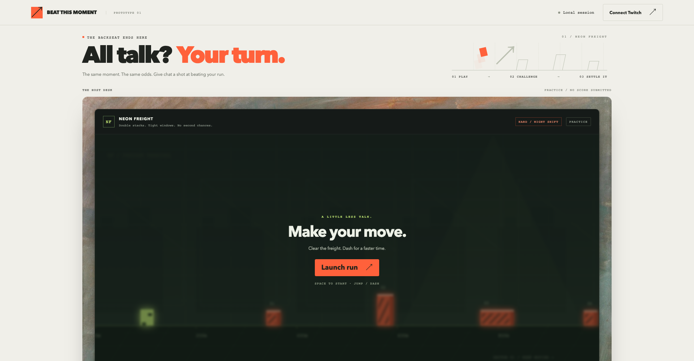
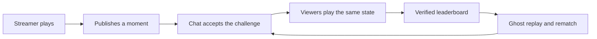
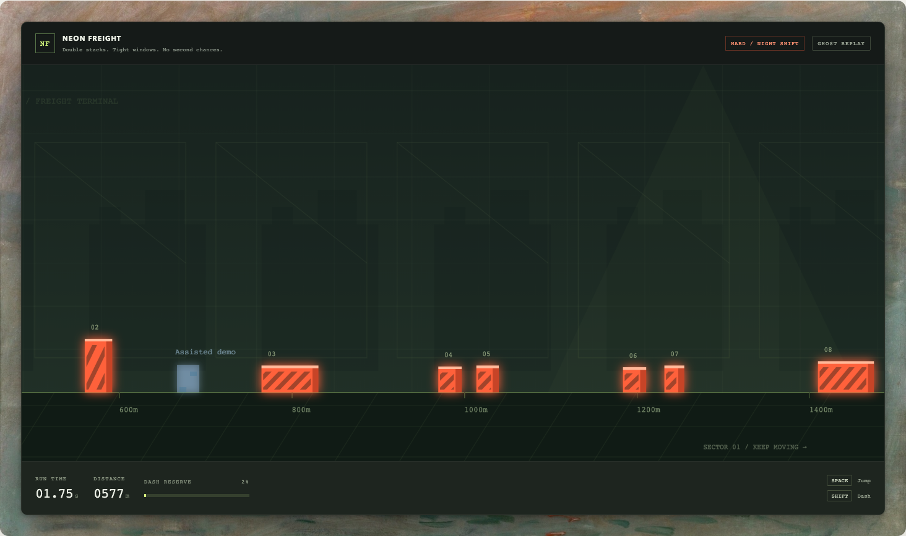
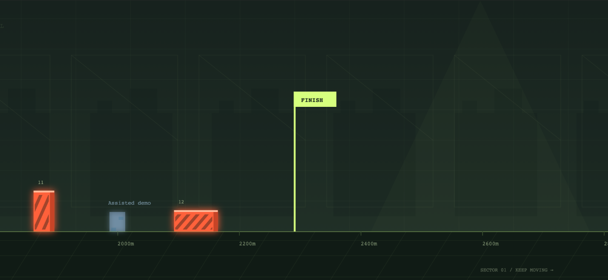
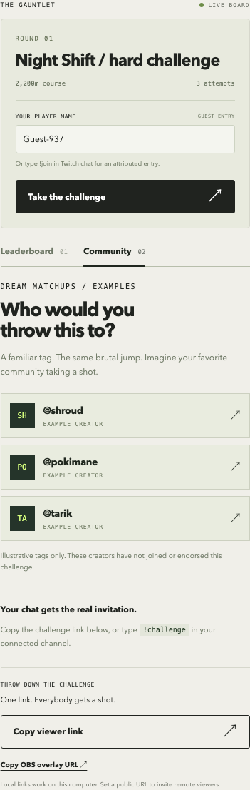

# Beat This Moment

[](https://github.com/0xtigerclaw/beat-this-moment/actions/workflows/test.yml) [](LICENSE)

### A streamer throws down a challenge. The community gets a shot.

“Think you can do better?” is a great invitation. **Beat This Moment** makes it playable.

A streamer crashes, saves a moment from just before the mistake, and challenges chat to beat it. Viewers open a link, start from the same game state, and put their attempt on a shared leaderboard. The fastest completed run becomes a ghost for everyone else to chase.

The idea is to give Twitch communities another way to participate in the moment together: a challenge to accept, a score to react to, and a rematch to come back for.



**[Play the live challenge](https://beat-the-moment-35-211-225-40.sslip.io/play)** · [GCP deployment](deploy/GCP.md)

[Watch the narrated prototype draft](demo/beat-this-moment-draft.mp4) · [Demo outline](demo/DEMO-SCRIPT.md) · [Verification notes](docs/QA.md)

> Working hackathon prototype, built with Codex. The included video is a draft; it still needs footage of host publication, the real chat interaction, and the Codex build process.

## Why this could matter for Twitch

A shared challenge gives a streamer a new way to involve the community in what just happened. A missed jump can become a race; a good run can become the time everyone is trying to beat.

The engagement hypothesis is simple: **make the stream's memorable moments something viewers can take part in, and give their participation a visible place in the stream.**

| Participant | What a challenge adds |
| --- | --- |
| Streamer | A prompt for participation and a reason to revisit the community's attempts on stream. |
| Viewer | A quick way to try the same moment, compare a result, and challenge the leading ghost. |
| Community | A shared objective, recognizable contenders, and an ongoing rematch. |
| Twitch | A possible loop connecting chat, gameplay, and the live broadcast. |
| Game developer | A way to make a specific game moment playable through a Twitch community. |

## Why small games belong on Twitch

AI is making games far easier to build. One person with a good idea can now ship something playable in days. That means more indie developers, and we are already seeing more small games come out.

Twitch should not be limited to big AAA titles. Small, quick games have their own strengths: anyone can open one from a link, learn it in seconds, and try again right away. They are a natural fit for a live community, and they are always fun.

This is an amazing opportunity for Twitch. With an integration like this, a smaller game developer could build a community around a small, quick game, and a streamer could give chat a game to play together. Beat This Moment is one small example: a quick game, built with Codex, that connects to chat and gives viewers a shared leaderboard and a reason to come back.

## The experience

1. **Sign in with Twitch.** The streamer connects their channel through Twitch's own sign-in, which unlocks the host desk and the chat bot.
2. **Find the moment.** The streamer plays Neon Freight, our jump-and-dash browser game.
3. **Throw down the challenge.** After a crash, publish a saved state from shortly before it.
4. **Invite chat.** The bot posts the challenge, and `!challenge` returns the current playable link. `!join` gives a viewer a link that races under their Twitch name, and anyone can also enter as a guest.
5. **Give everyone the same start.** Each attempt restores the same position, motion, energy, course seed, and simulation state.
6. **Bring the results back.** Server-verified attempts update the leaderboard and OBS overlay.
7. **Make it a rematch.** Replay the leading run or race alongside its ghost.



## How Twitch identity works

| Who | How they enter | What it establishes |
| --- | --- | --- |
| Streamer | Signs in with Twitch OAuth, granting `user:read:chat` and `user:write:chat`. | The server validates the token with Twitch and checks the exact owner login before unlocking the host desk. Other accounts are refused. |
| Viewer using `!join` | Types `!join` in chat. Twitch's EventSub tells the bot who sent it, and the bot replies with a single-use, ten-minute link. | The run carries that chatter's Twitch name and shows **VIA TWITCH CHAT** on the board. The link is visible in chat, so this is not a viewer login. |
| Guest | Types a name and plays. | Nothing. The run shows **GUEST**. |

No Twitch password ever reaches this app. A host key remains as a fallback for deployments without Twitch sign-in.

## Gameplay gallery

**The hard course, captured directly from the running game.** The current round, Night Shift, is a 2,200m course with 12 hazards: a small opening crate to teach the jump, then tall walls, wide barriers, and double stacks with tight jump windows. The original 1,600m, six-hazard course is kept as course version 1, so earlier challenge links and ghost replays still play exactly as recorded.



**A winning run to chase.** The ghost replay follows the recorded inputs through the final hazards toward the finish.



**The community panel, from the hosted game.** Everything sits under the game: the entry bar, a live board where completed runs rank above crashes and every entry can be replayed, and an invite card with a ready-to-paste message and the chat commands. The tags in the card are made-up examples.



The gameplay screenshots above come from a local test server and show a labeled sample run, found by an input search over the real simulation. The hosted board holds only real attempts.

## A path to deeper game integration

The larger opportunity is an integration between the game and the live community. A game that can expose a restorable checkpoint could let a streamer share a challenge tied to an exact encounter, route, puzzle, or attempt.

This prototype demonstrates the core contract:

**Capture state → share a challenge → restore that state → record inputs → verify the result → return it to the community.**

Here, we own the game and can implement that contract directly. Supporting another game would require its developer to expose suitable state capture, restoration, and result validation. A future SDK or game adapter could package those capabilities; no general-purpose game SDK is implemented yet.

**Current scope:** one purpose-built browser game. The prototype does not turn arbitrary Twitch video into playable game state or integrate with commercial games automatically.

## Under the hood

- **Canvas game:** original procedural art, keyboard and touch controls, fixed-timestep simulation.
- **Shared engine:** browser and server use the same simulation to restore snapshots and replay inputs.
- **Verified results:** clients submit inputs; the server calculates the score.
- **Twitch chat:** broadcaster OAuth, EventSub WebSockets, and the Send Chat Message API.
- **Live board:** SSE updates, with two-second polling for temporary Cloudflare Quick Tunnels.
- **OBS:** a compact game layout plus a transparent, read-only leaderboard source.
- **Persistence:** challenge history and attempts stored as JSON by a single Node process.

The prototype has been tested in separate browser sessions, used in real Twitch chat on the hosted game, and broadcast to `0xtigerclaw`. Playback was verified in a separate signed-out Twitch viewer. See [the verification notes](docs/QA.md) for evidence and the distinction between live and mocked checks.

## Setup and operation

### Run locally

Requires Node.js 22.15 or newer, with Node 24 recommended. There are no npm packages to install.

```sh
git clone https://github.com/0xtigerclaw/beat-this-moment.git
cd beat-this-moment
npm start
```

Open **http://localhost:3000**. Add `?broadcast=1` for the compact streaming layout. The host desk unlocks automatically on the local machine when `HOST_KEY` is unset. Viewers use `/c/<challenge-id>`. The read-only OBS browser source is `/overlay` (420 × 430, transparent background).

### Play and publish

1. Click **Launch run**. Space / Up / W jumps; hold Shift to dash. Touch controls are available on smaller screens.
2. On a crash or finish, click **Challenge chat**. The app selects a grounded snapshot roughly 1.7 seconds before the moment, when available.
3. Copy the viewer link and open it in a different browser or private window. Choose a guest name and race.
4. The server replays the recorded inputs, calculates the result, and updates the board. A finish beats a crash; finishes rank by time, crashes by distance. Ties use fewer jumps, then earlier submission.
5. Click a replay button to watch a run. In challenge mode, the current leader's ghost appears alongside you automatically.

The active challenge is also playable before you publish a custom moment. Practice runs are not submitted to the board. Published moments include position, vertical velocity, energy, jump-held state, jump count, course seed and simulation frame.

### Connect your Twitch channel

The game works without Twitch. To demonstrate the live integration:

1. Create a Twitch account and enable 2FA if required by the developer console.
2. Register an application at <https://dev.twitch.tv/console/apps> (a web/chat application category is suitable).
3. Register this exact OAuth redirect URL: `http://localhost:3000/auth/callback`.
4. Copy `.env.example` to `.env`, fill in `TWITCH_CLIENT_ID` and `TWITCH_CLIENT_SECRET`, and restart the server. Do not commit the file or paste its secret into chat.
5. Click **Connect Twitch**, then **Sign in with Twitch**. Authorize as the broadcaster whose channel will host the game.
6. In that channel's Twitch chat, type:
   - `!challenge`: replies with the active challenge link.
   - `!join`: replies with a single-use, ten-minute entry link attributed to the chatter. Subsequent retries in the same page retain that identity for one hour.

The bot also posts on its own when you publish a challenge and when a finished run takes the lead on the active challenge. Lead announcements are spaced at least 30 seconds apart and name the latest leader. To keep a busy chat readable, `!challenge` replies at most once every 15 seconds, since everyone can see the link, and all bot messages share a budget of 15 every 30 seconds.

The integration uses a broadcaster user access token with `user:read:chat user:write:chat`, an EventSub WebSocket subscription to `channel.chat.message`, and the Send Chat Message API. Tokens are validated at connection and every 55 minutes and refreshed when needed. By default they stay in memory and are discarded on restart. Set `TWITCH_TOKEN_FILE` and `TWITCH_OWNER_CHANNEL` to save them in a private file and restore the owning broadcaster after restart. The file must be outside the public directory; it is written with mode 0600, and disconnecting Twitch deletes it. Browser host sessions still require sign-in after a restart. EventSub reconnects after interruptions; missed Twitch events are not replayed. Chat replies have a per-user ten-second cooldown and are deduplicated.

Set `TWITCH_OWNER_CHANNEL` to your owning Twitch login. With this set, the owner can sign in directly with Twitch, without copying the host key into the browser. The callback checks a short-lived HttpOnly OAuth nonce cookie and a single-use state, validates the token and scopes with Twitch, and checks the exact owner login before granting a host session. Other Twitch accounts cannot take over the broadcaster connection or host desk. Leave this setting empty to require an existing host session before starting Twitch authorization.

**Moderation:** guest names pass a basic filter for common slurs, and `BLOCKED_NAMES` adds your own comma-separated terms. The filter will miss things, so the host desk shows a remove button beside each board entry. It removes all of that player's runs from that challenge. Twitch names are not filtered.

**Identity limitation:** `!join` links are bearer links visible in chat. Someone who copies another person's unused link can claim it. The label means “Twitch chat entry,” not independently authenticated browser ownership. Guests have no verified identity. A public competitive release should use viewer OAuth and account-bound sessions.

### Remote viewers and hosting

The live demo runs independently on GCP; see [deployment and budget details](deploy/GCP.md). For another deployment, localhost links only work on the computer running the server. For remote viewers, use a Node-capable public host or an HTTPS tunnel to port 3000.

- Set `PUBLIC_URL` to the public HTTPS origin, without a trailing slash.
- Set a long, random `HOST_KEY`. Remote host controls require this key; enter it in the app's setup dialog. It is never included in public state or challenge links.
- If binding directly to the network, set `HOST=0.0.0.0`. The server refuses non-local binding without `HOST_KEY`.
- Behind a reverse proxy, set `TRUST_PROXY=1` so each player gets their own rate limit. Without it, every player arrives from the proxy's address and shares one limit. The server then reads the rightmost `X-Forwarded-For` entry, so the proxy must overwrite or append to that header, as Caddy does by default. Leave it off when clients connect directly, or they could fake the header to dodge the limit.
- Register the corresponding `https://your-host/auth/callback` redirect URL in Twitch's developer console, then restart and reauthorize.
- Set `DATA_DIR` to a persistent state directory, or keep the same `.data/` directory across restarts. This prototype is a single Node process with JSON storage, not a multi-instance service. Hosting on an ephemeral filesystem loses scores.

Host sessions are HttpOnly cookies with an eight-hour lifetime. Credentials and host keys stay server-side. POST routes reject cross-origin browser requests and are limited per address, to 600 a minute for gameplay and 10 a minute for `/api/host-session`. Scores are recomputed by the server rather than accepted from clients.

When `PUBLIC_URL` is a temporary `trycloudflare.com` URL, the board polls every two seconds because Quick Tunnels do not support SSE. The URL stops working when the tunnel process stops, and a restarted tunnel gets a different hostname. Update `PUBLIC_URL` and the Twitch OAuth redirect if that happens. This is temporary demo access, not independent production hosting.

## Verification

```sh
npm test
npm run check
```

Tests cover deterministic courses, the harder course version and its upgrade path, completable jump/dash mechanics, restoration from mid-jump snapshots, replay equivalence, malformed/incomplete run rejection, ranking, host authorization, cross-origin rejection, independent guest entry, duplicate submission prevention, persistence across restarts, chat announcements and cooldowns, name filtering, and host removal.

Server-side replay prevents fabricated scores but **does not prevent bots, tool-assisted inputs, name impersonation, or determined cheating**. There is no prize/payment system. Twitch OAuth and live chat require your own app credentials and broadcaster authorization, and must be tested with an actual Twitch channel before a hackathon submission.

## Built with Codex

Codex was used to build and iterate on the game engine, saved-state challenge flow, interface, server-side verification, Twitch integration, tests, and demo setup. The [build contract](docs/BUILD.md) records the intended behavior, and [the verification notes](docs/QA.md) record what was actually verified.

The game's art is drawn procedurally in Canvas and CSS. The one outside image is the page's backdrop: Monet's *Impression, Sunrise* (1872), public domain, via [Wikimedia Commons](https://commons.wikimedia.org/wiki/File:Monet_-_Impression,_Sunrise.jpg). The idea of framing the game on a painting comes from [Monet Shot](https://github.com/SocialAcolyte/monet-shot). There are no third-party fonts, music, or game assets.

## What comes next

- Viewer OAuth for account-bound identities.
- Automated backups and a custom domain for the hosted challenges.
- Game adapters for titles that can expose restorable state.
- Streamer controls for challenge duration and rematches, and deeper moderation.
- Instrumentation to test whether challenges increase participation and repeat play.

## License

[MIT](LICENSE)

## References

- [Twitch chat authentication](https://dev.twitch.tv/docs/chat/authenticating/)
- [Sending and receiving chat messages](https://dev.twitch.tv/docs/chat/send-receive-messages/)
- [EventSub WebSockets](https://dev.twitch.tv/docs/eventsub/handling-websocket-events/)
- [OAuth authorization](https://dev.twitch.tv/docs/authentication/getting-tokens-oauth/)
- [Hackathon resources](https://twitchcon-codex.devpost.com/resources)
