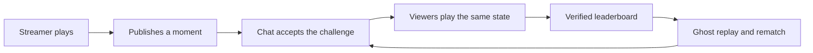
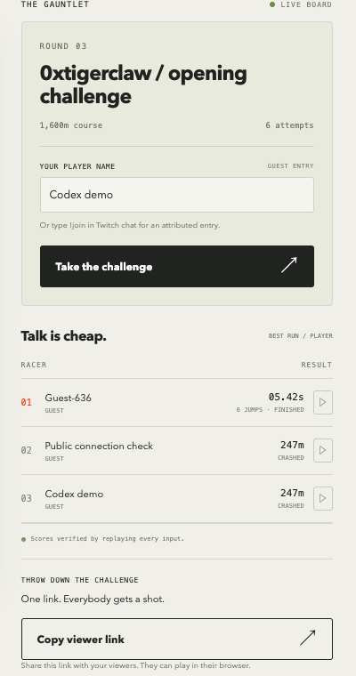

# Beat This Moment

### A streamer throws down a challenge. The community gets a shot.

“Think you can do better?” is a great invitation. **Beat This Moment** makes it playable.

A streamer crashes, saves a moment from just before the mistake, and challenges chat to beat it. Viewers open a link, start from the same game state, and put their attempt on a shared leaderboard. The fastest completed run becomes a ghost for everyone else to chase.

The idea is to give Twitch communities another way to participate in the moment together: a challenge to accept, a score to react to, and a rematch to come back for.


[Watch the narrated prototype draft](demo/beat-this-moment-draft.mp4) · [Demo outline](demo/DEMO-SCRIPT.md) · [Verification notes](QA.md)

> Working hackathon prototype, built with Codex. The included video is a draft; it still needs footage of host publication, the real chat interaction, and the Codex build process.

## Why this could matter for Twitch

A shared challenge gives a streamer a new way to involve the community in what just happened. A missed jump can become a race; a good run can become the time everyone is trying to beat.

The engagement hypothesis is simple: **make the stream's memorable moments something viewers can take part in, and give their participation a visible place in the stream.**

| Participant | What a challenge adds |
| --- | --- |
| Streamer | A prompt for participation and a reason to revisit the community's attempts on stream. |
| Viewer | A quick way to try the same moment, compare a result, and challenge the leading ghost. |
| Community | A shared objective, recognizable contenders, and an ongoing rematch. |
| Twitch | A possible loop connecting chat, gameplay, and the live broadcast. |
| Game developer | A way to make a specific game moment playable through a Twitch community. |

These are product hypotheses, not measured retention or engagement gains. A next experiment would track challenge opens, first attempts, repeat attempts, and viewers returning to the stream after playing.

## The experience

1. **Find the moment.** The streamer plays Neon Freight, our jump-and-dash browser game.
2. **Throw down the challenge.** After a crash, publish a saved state from shortly before it.
3. **Invite chat.** `!challenge` returns the current playable link. Viewers can enter as guests; `!join` provides a temporary chat-attributed entry link.
4. **Give everyone the same start.** Each attempt restores the same position, motion, energy, course seed, and simulation state.
5. **Bring the results back.** Server-verified attempts update the leaderboard and OBS overlay.
6. **Make it a rematch.** Replay the leading run or race alongside its ghost.



## Gameplay gallery

**The course, captured directly from the running game.** This is the start of Guest-636's recorded run.


**A winning run to chase.** The ghost replay follows the recorded inputs through the final obstacles toward the finish.


**The community board.** Completed runs rank above crashes; each entry can be replayed.



## A path to deeper game integration

The larger opportunity is an integration between the game and the live community. A game that can expose a restorable checkpoint could let a streamer share a challenge tied to an exact encounter, route, puzzle, or attempt.

This prototype demonstrates the core contract:

**Capture state → share a challenge → restore that state → record inputs → verify the result → return it to the community.**

Here, we own the game and can implement that contract directly. Supporting another game would require its developer to expose suitable state capture, restoration, and result validation. A future SDK or game adapter could package those capabilities; no general-purpose game SDK is implemented yet.

**Current scope:** one purpose-built browser game. The prototype does not turn arbitrary Twitch video into playable game state or integrate with commercial games automatically.

## Try it locally

```sh
git clone https://github.com/0xtigerclaw/beat-the-moment.git
cd beat-the-moment
npm start
```

Requires Node.js 22.15 or newer. There are no npm dependencies to install. Open [localhost:3000](http://localhost:3000), play a practice run, and publish a challenge. A second browser session can join through the generated viewer link. Twitch credentials are only needed for the chat integration.

## Under the hood

- **Canvas game:** original procedural art, keyboard and touch controls, fixed-timestep simulation.
- **Shared engine:** browser and server use the same simulation to restore snapshots and replay inputs.
- **Verified results:** clients submit inputs; the server calculates the score.
- **Twitch chat:** broadcaster OAuth, EventSub WebSockets, and the Send Chat Message API.
- **Live board:** SSE updates, with two-second polling for temporary Cloudflare Quick Tunnels.
- **OBS:** a compact game layout plus a transparent, read-only leaderboard source.
- **Persistence:** challenge history and attempts stored as JSON by a single Node process.

The prototype has been tested in separate browser sessions, connected to real Twitch chat, and broadcast to `0xtigerclaw`. Playback was verified in a separate signed-out Twitch viewer. See [QA.md](QA.md) for evidence and the distinction between live and mocked checks.

## Setup and operation

## Run locally

Requires Node.js 22.15+ (Node 24+ recommended). No npm packages or installation step required.

```sh
npm start
```

Open **http://localhost:3000**. Add `?broadcast=1` for the compact streaming layout. The host desk unlocks automatically on the local machine when `HOST_KEY` is unset. Viewers use `/c/<challenge-id>`. The read-only OBS browser source is `/overlay` (420 × 430, transparent background).

### Play and publish

1. Click **Launch run**. Space / Up / W jumps; hold Shift to dash. Touch controls are available on smaller screens.
2. On a crash or finish, click **Challenge chat**. The app selects a grounded snapshot roughly 1.7 seconds before the moment, when available.
3. Copy the viewer link and open it in a different browser or private window. Choose a guest name and race.
4. The server replays the recorded inputs, calculates the result, and updates the board. A finish beats a crash; finishes rank by time, crashes by distance. Ties use fewer jumps, then earlier submission.
5. Click a replay button to watch a run. In challenge mode, the current leader's ghost appears alongside you automatically.

The active challenge is also playable before you publish a custom moment. Practice runs are not submitted to the board. Published moments include position, vertical velocity, energy, jump-held state, jump count, course seed and simulation frame.

## Connect your Twitch channel

The game works without Twitch. To demonstrate the live integration:

1. Create a Twitch account and enable 2FA if required by the developer console.
2. Register an application at <https://dev.twitch.tv/console/apps> (a web/chat application category is suitable).
3. Register this exact OAuth redirect URL: `http://localhost:3000/auth/callback`.
4. Copy `.env.example` to `.env`, fill in `TWITCH_CLIENT_ID` and `TWITCH_CLIENT_SECRET`, and restart the server. Do not commit the file or paste its secret into chat.
5. Click **Connect Twitch**, then **Authorize my Twitch channel**. Authorize as the broadcaster whose channel will host the game.
6. In that channel's Twitch chat, type:
   - `!challenge`: replies with the active challenge link.
   - `!join`: replies with a single-use, ten-minute entry link attributed to the chatter. Subsequent retries in the same page retain that identity for one hour.

The integration uses a broadcaster user access token with `user:read:chat user:write:chat`, an EventSub WebSocket subscription to `channel.chat.message`, and the Send Chat Message API. Tokens are held in server memory, validated at connection and every 55 minutes, refreshed when needed, and discarded on restart. Reauthorize after a restart. EventSub reconnects after interruptions; missed Twitch events are not replayed. Chat replies have a per-user ten-second cooldown and are deduplicated.

Set `TWITCH_OWNER_CHANNEL` to your owning Twitch login. With this set, the owner can sign in directly with Twitch, without copying the host key into the browser. The callback checks a short-lived HttpOnly OAuth nonce cookie and a single-use state, validates the token and scopes with Twitch, and checks the exact owner login before granting a host session. Other Twitch accounts cannot take over the broadcaster connection or host desk. Leave this setting empty to require an existing host session before starting Twitch authorization.

**Identity limitation:** `!join` links are bearer links visible in chat. Someone who copies another person's unused link can claim it. The label means “Twitch chat entry,” not independently authenticated browser ownership. Guests have no verified identity. A public competitive release should use viewer OAuth and account-bound sessions.

## Remote viewers / hosting

Localhost links only work on the computer running the server. For remote viewers, use a Node-capable public host or an HTTPS tunnel to port 3000.

- Set `PUBLIC_URL` to the public HTTPS origin, without a trailing slash.
- Set a long, random `HOST_KEY`. Remote host controls require this key; enter it in the app's setup dialog. It is never included in public state or challenge links.
- If binding directly to the network, set `HOST=0.0.0.0`. The server refuses non-local binding without `HOST_KEY`.
- Register the corresponding `https://your-host/auth/callback` redirect URL in Twitch's developer console, then restart and reauthorize.
- Keep the same persistent `.data/` directory across restarts. This prototype is a single Node process with JSON storage, not a multi-instance service. Hosting on an ephemeral filesystem loses scores.

Host sessions are HttpOnly cookies with an eight-hour lifetime. Credentials and host keys stay server-side. POST routes reject cross-origin browser requests. Scores are recomputed by the server rather than accepted from clients.

When `PUBLIC_URL` is a temporary `trycloudflare.com` URL, the board polls every two seconds because Quick Tunnels do not support SSE. The URL stops working when the tunnel process stops, and a restarted tunnel gets a different hostname. Update `PUBLIC_URL` and the Twitch OAuth redirect if that happens. This is temporary demo access, not independent production hosting.

## Verification

```sh
npm test
npm run check
```

Tests cover deterministic courses, completable jump/dash mechanics, restoration from mid-jump snapshots, replay equivalence, malformed/incomplete run rejection, ranking, host authorization, cross-origin rejection, independent guest entry, duplicate submission prevention and persistence across restarts.

Server-side replay prevents fabricated scores but **does not prevent bots, tool-assisted inputs, name impersonation, or determined cheating**. There is no prize/payment system. Twitch OAuth and live chat require your own app credentials and broadcaster authorization, and must be tested with an actual Twitch channel before a hackathon submission.

## Built with Codex

Codex was used to build and iterate on the game engine, saved-state challenge flow, interface, server-side verification, Twitch integration, tests, and demo setup. The [build contract](BUILD.md) records the intended behavior, and [QA.md](QA.md) records what was actually verified.

All art is drawn procedurally in Canvas/CSS. There are no third-party images, fonts, music, or game assets in the app.

## What comes next

- Viewer OAuth for account-bound identities.
- Persistent cloud hosting and storage for challenges that outlive a local demo.
- Game adapters for titles that can expose restorable state.
- Streamer controls for challenge duration, moderation, and rematches.
- Instrumentation to test whether challenges increase participation and repeat play.

## References

- [Twitch chat authentication](https://dev.twitch.tv/docs/chat/authenticating/)
- [Sending and receiving chat messages](https://dev.twitch.tv/docs/chat/send-receive-messages/)
- [EventSub WebSockets](https://dev.twitch.tv/docs/eventsub/handling-websocket-events/)
- [OAuth authorization](https://dev.twitch.tv/docs/authentication/getting-tokens-oauth/)
- [Hackathon resources](https://twitchcon-codex.devpost.com/resources)
