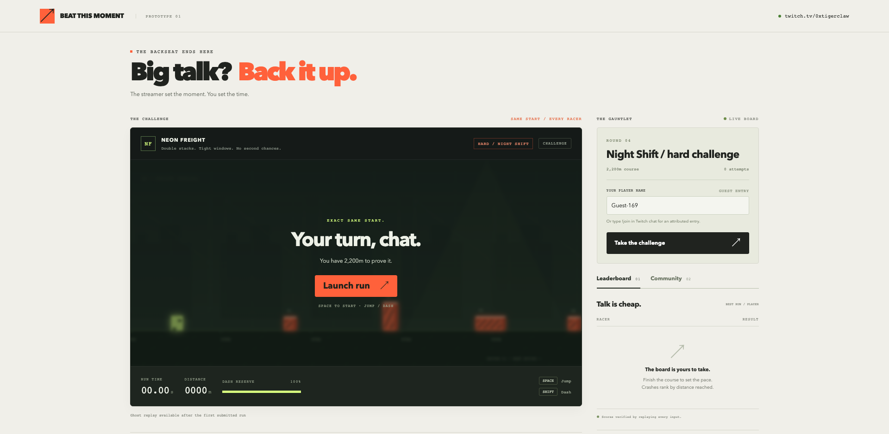

# GCP deployment

Live game: **https://beat-the-moment-35-211-225-40.sslip.io**



Project: `beat-the-moment-964ea6` · Region: `us-east1` · Zone: `us-east1-b`

## Deployment layout

A single Compute Engine `e2-micro` VM runs Node.js 24 and Caddy. This matches the prototype's single-process storage and keeps its outbound Twitch EventSub WebSocket active between player requests. Caddy provides HTTPS and proxies to Node on loopback port 3000. The VM has no attached Google service account. Public ingress is limited to HTTP/HTTPS; SSH is restricted to Google's IAP range.

| Item | Location |
| --- | --- |
| Application | `/opt/beat-this-moment` |
| Private configuration | `/etc/beat-this-moment.env`, root-owned, mode 0600 |
| Challenges and scores | `/var/lib/beat-this-moment/challenges.json` |
| Saved Twitch credentials | `/var/lib/beat-this-moment/twitch-session.json`, mode 0600 |
| Game service | `beat-this-moment.service`, unprivileged user `btm` |
| HTTPS proxy | `caddy.service` |

The 10 GB standard persistent boot disk retains data through process and VM restarts. Deleting the VM or project may delete its disk; persistent storage is not a backup. Host sessions and in-progress run tickets remain in memory, so users may need to sign in or start a fresh attempt after a restart. Saved Twitch credentials are validated and refreshed before restoring the configured owner's connection. Disconnecting Twitch deletes its saved credentials.

`/etc/beat-this-moment.env` must contain `TRUST_PROXY=1`. Node only sees connections from Caddy on loopback, so without this setting all players share one rate limit of 600 POSTs a minute. With it, each client address gets its own limit, read from the `X-Forwarded-For` value Caddy sets. [Caddy ignores client-sent values for that header by default](https://caddyserver.com/docs/caddyfile/directives/reverse_proxy#defaults), so players cannot fake it. Add `TRUST_PROXY=1` to that file when deploying this change, then run `sudo systemctl restart beat-this-moment`. `gcp-install.sh` replaces that file with the private configuration you give it, so include the setting there too.

The public hostname uses the reserved IPv4 address and sslip.io DNS. It remains stable while that address is retained. A custom domain can replace it later, with a corresponding change to `PUBLIC_URL`, Caddy, and Twitch's registered OAuth callback.

## Budget

A project-scoped monthly **EUR 10** budget has alerts at EUR 5, EUR 8, and EUR 10. These alerts do not enforce a spending cap.

The VM and disk are sized for [Google's Compute Engine Free Tier](https://docs.cloud.google.com/free/docs/free-cloud-features#free-tier). That allowance is shared across eligible usage on the billing account. The reserved IPv4 address is billed separately; Google's published USD list rate is $0.005/hour, approximately $3.65 for a 730-hour month. The account is billed in EUR, so its EUR SKU prices apply. Internet egress, usage beyond free allowances, and taxes can add charges. See [network pricing](https://cloud.google.com/vpc/network-pricing#ipaddress).

No load balancer, Cloud SQL instance, paid DNS zone, container registry, or autoscaling VM group is deployed.

## Administration

Use the Google account that owns the project. Keep credentials out of Git and command output.

```sh
gcloud compute ssh beat-the-moment \
  --project=beat-the-moment-964ea6 \
  --zone=us-east1-b \
  --tunnel-through-iap
```

On the VM:

```sh
sudo systemctl status beat-this-moment caddy
sudo journalctl -u beat-this-moment -n 50 --no-pager
curl -fsS http://127.0.0.1:3000/healthz
```

`gcp-startup.sh` bootstraps a fresh Debian 12 VM. `gcp-install.sh` installs an application archive and private environment file. The latter expects a hostname, a runtime tar path, and a private configuration path. Do not include credentials in instance metadata, startup scripts, source archives, or the repository. Review an update before installing it; preserve the existing state directory. The runtime archive must contain `package.json`, `server.mjs`, `twitch.mjs`, `moderation.mjs`, and `public/`.

## Stop and remove

Stopping the VM stops the app, but the reserved IPv4 address and disk can continue to incur charges. To retire the deployment, first save the challenge data if needed, then remove the VM, its disks, and the reserved address. Removing the dedicated project removes all its resources. Do not treat a VM stop as full billing cleanup.
